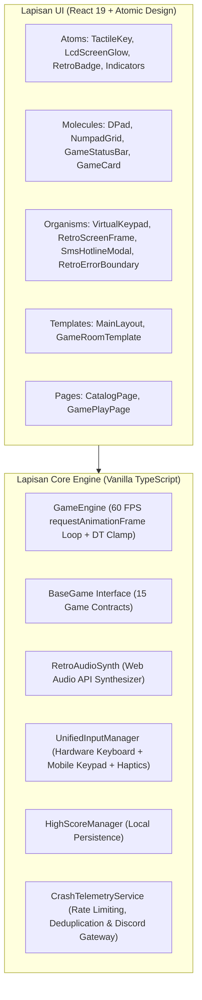

# 🕹️ RetroPocket Arcade — Museum Game HP Jadul (1998–2006)

[](https://github.com/herisusantoarismann/classic-game)
[](https://github.com/herisusantoarismann/classic-game)
[](https://github.com/herisusantoarismann/classic-game)
[](https://github.com/herisusantoarismann/classic-game)
[](https://opensource.org/licenses/MIT)

> **Platform Web Nostalgia Interaktif Berstandar Tinggi**  
> Rekreasi clean-room 15 game legendaris era monokrom dan Java J2ME tanpa emulator berat, 100% offline PWA, synthesizer audio 8-bit prosedural, dan kontrol keypad fisik & virtual taktil.

---

## 🌟 Daftar Isi
- [📖 Panduan untuk Pemain & Orang Awam](#-panduan-untuk-pemain--orang-awam)
  - [Apa itu RetroPocket Arcade?](#apa-itu-retropocket-arcade)
  - [Koleksi 15 Game Legendaris](#koleksi-15-game-legendaris)
  - [Fitur Ekstra Nostalgia](#fitur-ekstra-nostalgia)
  - [Panduan Cara Main (HP & PC)](#panduan-cara-main-hp--pc)
  - [Cara Memasang Aplikasi ke Ponsel (PWA)](#cara-memasang-aplikasi-ke-ponsel-pwa)
- [💻 Panduan untuk Developer & Kontributor](#-panduan-untuk-developer--kontributor)
  - [Filosofi Desain & Anti-AI Slop](#filosofi-desain--anti-ai-slop)
  - [Arsitektur Teknis & Teknologi](#arsitektur-teknis--teknologi)
  - [Struktur Folder (Atomic Design)](#struktur-folder-atomic-design)
  - [Cara Menjalankan di Lokal](#cara-menjalankan-di-lokal)
  - [Konfigurasi Webhook Discord (.env)](#konfigurasi-webhook-discord-env)
  - [Sistem Pengujian Otomatis (QA Bot & Audit)](#sistem-pengujian-otomatis-qa-bot--audit)
  - [Kontrak Game Engine (BaseGame)](#kontrak-game-engine-basegame)
  - [Sistem Telemetri Crash & Error Boundary](#sistem-telemetri-crash--error-boundary)
- [📚 Dokumentasi Lanjutan](#-dokumentasi-lanjutan)

---

# 📖 Panduan untuk Pemain & Orang Awam

### Apa itu RetroPocket Arcade?
Ingatkah kamu masa-masa di mana ponsel Nokia 3310, Siemens C45, atau Sony Ericsson menjadi perangkat paling seru di tanganmu? Saat baterai HP tahan berhari-hari dan hiburan terbaik adalah mengejar ekor ular atau memantulkan bola merah?

**RetroPocket Arcade** adalah museum game online yang menghidupkan kembali kenangan tersebut langsung di browsermu:
- 🚫 **Tanpa Download Emulator**: Tidak perlu install aplikasi rumit atau unduh file ROM `.jar`/`.bin` bajakan.
- ⚡ **Instan & Ringan**: Cukup buka tautan web, pilih game, dan langsung main dalam hitungan detik.
- 📱 **Keypad Taktil Asli**: Di layar sentuh HP, tampil keypad virtual lengkap dengan tombol arah (D-Pad), angka 1-9, softkey, getaran haptik, dan bunyi klik tombol jadul.
- ✈️ **100% Bisa Dimainkan Offline**: Setelah dibuka sekali, game tetap bisa dimainkan di pesawat atau daerah tanpa sinyal internet.

---

### Koleksi 15 Game Legendaris

Seluruh game dibuat ulang secara legal (*clean-room tribute*) dengan grafis piksel autentik dan efek suara asli era monokrom hingga warna polifonik:

| Game di RetroPocket | Tribute Game Asli | Era & Tahun | Deskripsi Permainan |
| :--- | :--- | :--- | :--- |
| **Retro Snake** | *Snake Xenzia / II (Nokia)* | Monokrom (1998) | Kendalikan ular hijau dot-matrix, makan serangga berkedip, hindari menabrak badan sendiri. |
| **Cosmic Impact** | *Space Impact (Nokia)* | Monokrom (2000) | Tembak-menembak pesawat luar angkasa horizontal, luncurkan roket sekunder, kalahkan bos alien raksasa. |
| **Bantumi** | *Bantumi Congklak (Nokia)* | Monokrom (1999) | Game strategi tradisional congklak/mancala melawan AI bot 10 level keahlian atau lawan teman (2P Pass & Play). |
| **Memory Pairs** | *Pairs / Memory (Nokia)* | Monokrom (1999) | Uji ketajaman ingatan dengan membuka pasangan kartu simbol retro berwaktu. |
| **Rapid Fall** | *Rapid Roll (Nokia)* | Monokrom (2003) | Turunkan bola melewati platform berjalan, hindari duri langit-langit, dan kumpulkan permata. |
| **Stack Attack** | *Stack Attack (Siemens C45)* | Monokrom (2001) | Bantu kuli pelabuhan menggeser peti kargo jatuh untuk membentuk garis penuh horizontal. |
| **Red Bounce** | *Bounce / Bounce Tales (Nokia)* | J2ME Warna (2002) | Pantulkan bola karet merah melewati cincin emas, pompa bola membesar, dan hindari paku maut. |
| **Tower Bloxx** | *Tower Bloxx (Digital Chocolate)* | J2ME Warna (2005) | Jatuhkan balok bangunan dari derek berayun dengan kombo presisi untuk membangun gedung pencakar langit. |
| **Diamond Relic** | *Diamond Rush (Gameloft)* | J2ME Warna (2006) | Pecahkan teka-teki kuil kuno Angkor Wat, dorong batu besar, kumpulkan permata, hindari kobra berbisa. |
| **Neon Breaker** | *Block Breaker Deluxe (Gameloft)* | J2ME Warna (2004) | Hancurkan bata neon kelab malam berkecepatan tinggi dengan paddle pantul, laser ganda, dan multiball. |
| **Midnight 8-Ball** | *Midnight Pool (Gameloft)* | J2ME Warna (2006) | Simulasi kasual biliar 8-ball dengan meja felt hijau, garis panduan lintasan sudut, dan pengukur tenaga stik. |
| **Retro Football 2D** | *Real Football / PES J2ME* | J2ME Warna (2005) | Turnamen sepak bola mini 5v5 dengan operan tombol `5`, tekel pertahanan, sprint turbo tombol `3`, dan shooting gawang `0`. |
| **Retro Asphalt GT** | *Asphalt: Urban GT (Gameloft)* | 3D Classic (2004) | Balapan liar jalan raya berkecepatan tinggi, jalan melengkung pseudo-3D, salip kendaraan lalu lintas, dan aktifkan booster nitro. |
| **Persian Sands** | *Prince of Persia: Harem Nights* | 2D/3D Plat (2003) | Petualangan akrobatik sinematik melompati celah jurang, gelantungan di tepi pilar, menghindari lantai duri, dan duel pedang. |
| **Galaxy Void** | *Galaxy on Fire (Fishlabs)* | 3D Space (2006) | Pertempuran kokpit pesawat tempur 3D sejati, bidik laser plasma ke asteroid dan armada induk alien, lakukan warp drive. |

---

### Fitur Ekstra Nostalgia

Selain 15 game di atas, RetroPocket Arcade menyediakan ragam fitur unik era ponsel klasik:
1. 🎵 **Komposer Nada Dering Nokia (Nokia Composer)**:
   - Buat melodi monophonic sendiri menggunakan tombol angka ponsel (misal nada `4e1 4g1 4a1`), mainkan kembali bunyinya, atau pilih preset legendaris (Nokia Tune, Badinerie, Minuet).
2. 🎨 **Studio Logo Operator 1-Bit**:
   - Gambar logo operator hitam-putih 72x14 piksel sendiri seperti di era Nokia 3310! Logo yang kamu gambar akan otomatis terpajang di status bar atas layar permainan.
3. ✉️ **Hotline SMS 3310 (Kotak Saran 160 Karakter)**:
   - Ingin usul game masa kecil favoritmu dimasukkan ke museum? Atau menemukan tombol error di tipe HP tertentu? Kirim pesan SMS 160 karakter dengan nada SMS 4-pulse Nokia. Pesanmu otomatis masuk ke Discord kurator.
4. 🏆 **Album Kolektor & Kartu Pamer Skor (MMC)**:
   - Rekor skormu tersimpan aman di HP. Setiap kali mencetak rekor baru, kamu bisa mengunduh kartu bergaya MMC Card bertatahkan pin emas lengkap dengan link duel rival untuk menantang kawanmu.

---

### Panduan Cara Main (HP & PC)

#### 📱 Jika Bermain di Smartphone (Layar Sentuh):
- **D-Pad / Tombol Arah**: Sentuh panah Atas, Bawah, Kiri, Kanan untuk menggerakkan karakter.
- **Tombol Angka (Numpad 1–9)**: Berfungsi layaknya ponsel fisik (misal: tombol `2` untuk Lompat/Atas, `4` Kiri, `6` Kanan, `8` Bawah, `5` Aksi/Oper).
- **Softkey Kiri & Kanan**: Tombol horizontal di bawah layar LCD untuk memilih opsi menu atau konfirmasi.
- **Efek Getar (Haptics)**: Setiap tombol ditekan memberikan getaran taktil halus (bisa dimatikan di menu Pengaturan).

#### 💻 Jika Bermain di Laptop / Komputer Desktop:
- **Navigasi Gerak**: Gunakan tombol **Tombol Panah** (`↑`, `↓`, `←`, `→`) atau tombol **W / A / S / D**.
- **Tombol Aksi Utama**: Tekan **Spasi**, **Enter**, atau tombol **5**.
- **Jeda Permainan**: Tekan tombol **P** atau **ESC**.
- **Numpad Fisik**: Angka `0` s/d `9`, `*`, dan `#` pada keyboard komputer terhubung langsung ke game.

---

### Cara Memasang Aplikasi ke Ponsel (PWA)

Kamu bisa memasang RetroPocket Arcade ke layar utama ponselmu seperti aplikasi native dari Google Play Store / App Store, **tanpa memakan memori besar**:
- **Di Ponsel Android (Chrome)**: Klik tombol kuning **[ PASANG APP ]** di bagian atas web, atau klik menu titik tiga `⋮` di Chrome > pilih **"Tambahkan ke Layar Utama" / "Install App"**.
- **Di iPhone / iPad (Safari)**: Klik tombol **Share** (kotak berpanah ke atas) di bagian bawah browser Safari > pilih **"Add to Home Screen" (Tambahkan ke Layar Utama)**.

---

# 💻 Panduan untuk Developer & Kontributor

> Dokumen ini ditujukan untuk software engineer yang ingin memahami arsitektur, berkontribusi pada kode program, atau menjalankan proyek secara lokal.

### Filosofi Desain & Anti-AI Slop

Proyek ini dibangun dengan komitmen rekayasa ketat:
1. **No AI Slop in Code**:
   - Dilarang membuat kode *bloated*, abstraksi berlapis prematur, atau komentar basa-basi AI.
   - Mengutamakan vanilla TypeScript ringkas daripada memasang dependensi npm pihak ketiga berukuran megabyte.
2. **No AI Slop in Design**:
   - Menolak template dashboard gelap generik SaaS AI.
   - Mengusung estetika **Warm Vintage Hardware & Y2K Web Retro**: casing hardware hangat (`#f0ebe1`, `#e2ddd1`), aksen biru Nokia (`#144299`), layar LCD hijau dot-matrix (`#879571`), dan tombol keypad 3D taktil.
3. **Performa Ekstrem (Skor Audit 100/100)**:
   - **Zero External Web Fonts**: Tidak mengimpor Google Fonts eksternal. Menggunakan font stack native modern untuk UI umum dan font piksel mandiri (~7.5 kB self-hosted WOFF2) untuk menghilangkan layout shift (CLS = 0).
   - **Procedural Web Audio API**: Seluruh efek suara, melodi polifonik, dan nada SMS disintesis secara real-time via Web Audio API tanpa mengunduh file MP3/WAV eksternal (0 kB audio asset bloat).
   - **Modular Dynamic Code Splitting**: Seluruh 15 game diisolasi ke dalam dynamic chunks mandiri. Bundle awal app shell tetap ringan (~117 kB gzipped).

---

### Arsitektur Teknis & Teknologi



- **Runtime & Build Tool**: [Vite 8](https://vitejs.dev/) + [TypeScript 6](https://www.typescriptlang.org/)
- **UI Framework**: [React 19](https://react.dev/)
- **Styling**: [Tailwind CSS v4](https://tailwindcss.com/)
- **Icons**: [Lucide React](https://lucide.dev/)
- **Linter**: [Oxlint](https://oxc.rs/) (linter Rust ultra-cepat, 0 warnings / 0 errors)
- **Audio Engine**: Native Web Audio API procedural synthesis (`OscillatorNode`, `GainNode`)
- **Render Engine**: HTML5 Canvas 2D Context berpresisi tinggi dengan transform scaling responsif

---

### Struktur Folder (Atomic Design)

```
c:\Project\classic_game\
├── docs/                                  # Dokumentasi arsitektur mendalam
│   ├── ARCHITECTURE.md                    # Detail kontrak BaseGame, loop fisika & telemetri
│   ├── DESIGN_SYSTEM.md                   # Palet warna, spesifikasi LCD dot-matrix & keypad
│   └── ROADMAP.md                         # Riwayat fase 1 s/d fase 15
├── public/                                # Aset statis PWA & crawler
│   ├── fonts/                             # Font piksel self-hosted woff2 (~7.5 kB)
│   ├── manifest.webmanifest               # Manifest PWA standalone
│   ├── sw.js                              # Cache-First Service Worker
│   ├── robots.txt & sitemap.xml           # Crawler indexing 15 tautan game
│   └── icon.svg, favicon.svg, og-image.png# Aset branding vector & raster
├── src/
│   ├── components/                        # Komponen antarmuka (Atomic Design)
│   │   ├── atoms/                         # TactileKey, SignalIndicator, RetroPocketLogo, dll.
│   │   ├── molecules/                     # DPad, NumpadGrid, GameCard, CollectorProgressCard
│   │   ├── organisms/                     # VirtualKeypad, RetroScreenFrame, SmsHotlineModal, RetroErrorBoundary
│   │   ├── templates/                     # MainLayout, GameRoomTemplate
│   │   └── pages/                         # CatalogPage, GamePlayPage
│   ├── core/                              # Logika platform independen (Framework Agnostic)
│   │   ├── audio/RetroAudioSynth.ts       # Synthesizer 8-bit Web Audio API
│   │   ├── engine/                        # GameEngine.ts, BaseGame.ts, types.ts
│   │   ├── input/UnifiedInputManager.ts   # Normalisasi input keyboard + sentuhan virtual
│   │   ├── storage/HighScoreManager.ts    # Enkapsulasi penyimpanan rekor skor
│   │   ├── services/                      # SmsHotlineService.ts, CrashTelemetryService.ts
│   │   └── testing/                       # Autonomous Simulation QA Bot & Audit Suites
│   ├── games/                             # Modul logika 15 permainan individu
│   │   ├── snake/                         # Retro Snake (Xenzia)
│   │   ├── space-impact/                  # Cosmic Impact
│   │   ├── bantumi/                       # Bantumi (Congklak)
│   │   ├── bounce/                        # Red Bounce (Bounce Tales)
│   │   ├── catalog.ts                     # Metadata 15 game untuk katalog
│   │   ├── instructions.ts                # Panduan tombol tiap game
│   │   └── loader.ts                      # Dynamic lazy import loader
│   ├── App.tsx                            # Root application component & routing
│   ├── main.tsx                           # Entry point dengan Error Boundary & Telemetry
│   └── index.css                          # Tailwind CSS v4 & font-face declarations
├── package.json
└── tsconfig.json
```

---

### Cara Menjalankan di Lokal

#### Prasyarat:
- [Node.js](https://nodejs.org/) versi 18.0 atau lebih baru.
- npm atau pnpm.

#### Langkah Instalasi:
1. **Clone repository ini:**
   ```bash
   git clone https://github.com/herisusantoarismann/classic-game.git
   cd classic-game
   ```
2. **Install dependensi:**
   ```bash
   npm install
   ```
3. **Jalankan local development server:**
   ```bash
   npm run dev
   ```
   Buka browser di `http://localhost:5173/` untuk mulai bermain.

4. **Kompilasi build produksi:**
   ```bash
   npm run build
   ```
   Hasil build siap deploy akan berada di folder `dist/`.

---

### Konfigurasi Webhook Discord (.env)

Fitur **Hotline SMS 3310** dan **Automated Crash Telemetry** dapat mengirim notifikasi otomatis langsung ke channel Discord timmu tanpa perlu server backend!

1. Salin template `.env.example` ke `.env`:
   ```bash
   cp .env.example .env
   ```
2. Buka file `.env` dan masukkan Webhook URL dari channel Discord milikmu:
   ```env
   VITE_DISCORD_WEBHOOK_URL=https://discord.com/api/webhooks/CHANNEL_ID/WEBHOOK_TOKEN
   ```
> [!NOTE]
> Jika `VITE_DISCORD_WEBHOOK_URL` dikosongkan (misal saat offline atau di lingkungan dev lokal), aplikasi akan secara otomatis menyimpan pesan dan laporan crash ke `localStorage` (`retropocket_outbox_sms`) secara anggun tanpa memunculkan error jaringan.

---

### Sistem Pengujian Otomatis (QA Bot & Audit)

RetroPocket Arcade dilengkapi dengan suite pengujian otomatis menyeluruh:

```bash
# Menjalankan seluruh rangkaian tes (15 game bot, shell, dan audit)
npm test

# Menjalankan verifikasi 15 game dengan bot otonom (10-Stage sweep, anti-leak & anti-crash)
npx tsx src/core/testing/runAllGamesTest.ts

# Menjalankan verifikasi sistem shell, penyimpanan skor, PWA, dan telemetri
npx tsx src/core/testing/runAppShellTest.ts

# Menjalankan audit skor SEO, Performance & CRO (Batas lulus >= 95/100)
npm run audit:seo-perf

# Menjalankan linting kode statis ultra-cepat
npm run lint
```

#### Spesifikasi Bot Simulasi ([`GameSimulationBot.ts`](file:///c:/Project/classic_game/src/core/testing/GameSimulationBot.ts)):
- **3-Phase Verification**: Menguji Survival Streak (5.000 ticks), Culling Leak Check (memastikan objek musuh/peluru tidak bocor di luar layar), dan Difficulty Scaling.
- **10-Stage Sweep**: Menguji lompatan dari Stage 1 hingga Stage 10 dengan input heuristik dinamis dan uji lonjakan lag (*dt-spike* 80ms) untuk memastikan **0 crash** dan **0 nilai `NaN`**.
- **Stage Reset Integrity**: Memastikan pemanggilan `game.reset()` setelah Stage 10 berhasil mengembalikan permainan ke Stage 1 dan kecepatan awal.

---

### Kontrak Game Engine (`BaseGame`)

Setiap game retro baru wajib mengimplementasikan interface [`BaseGame`](file:///c:/Project/classic_game/src/core/engine/BaseGame.ts) agar dapat diisolasi dan dijalankan di dalam [`RetroScreenFrame`](file:///c:/Project/classic_game/src/components/organisms/RetroScreenFrame.tsx):

```typescript
export interface BaseGame {
  readonly id: string;
  readonly title: string;
  readonly tributeTo: string;
  readonly era: 'monochrome' | 'color-j2me' | 'cult-3d';
  readonly canvasSize: { width: number; height: number };
  readonly isEndless?: boolean;

  // 10-Stage Progression
  currentStage?: number;
  readonly maxStages?: number;
  setStage?(stage: number): void;

  init(
    canvas: HTMLCanvasElement,
    audio: RetroAudioSynth,
    callbacks?: GameCallbacks
  ): void;
  update(deltaTime: number): void;
  render(ctx: CanvasRenderingContext2D): void;
  handleInput(action: InputAction): void;
  handleInputRelease?(action: InputAction): void;
  reset(): void;
  destroy(): void;
}
```

---

### Sistem Telemetri Crash & Error Boundary

Untuk memastikan keandalan jangka panjang, aplikasi dilengkapi sistem penangkap crash otomatis:
- **`RetroErrorBoundary`**: Menangkap crash rendering React dan menampilkan layar Nokia Series 30 `★ CONTACT SERVICE ★` sehingga pengguna tidak melihat layar putih kosong.
- **`CrashTelemetryService`**:
  - Mencegah *spam webhook* melalui deduplikasi berbasis sidik jari error (`name::message::location`).
  - Menerapkan batasan interval kirim minimal 3 detik dan maksimal 5 laporan per sesi.
  - Memfilter *noise* seperti `ResizeObserver loop` dan ekstensi browser pihak ketiga.
  - Mengirimkan detail stack trace, resolusi layar, browser, serta game yang sedang dimainkan langsung ke Discord.

---

# 📚 Dokumentasi Lanjutan

Untuk pembahasan teknis yang lebih mendalam, silakan pelajari dokumen arsitektur berikut:
- 🏛️ [**docs/ARCHITECTURE.md**](file:///c:/Project/classic_game/docs/ARCHITECTURE.md): Kontrak engine, loop fisika delta-time, formula kalkulasi skor, dan sistem telemetri.
- 🎨 [**docs/DESIGN_SYSTEM.md**](file:///c:/Project/classic_game/docs/DESIGN_SYSTEM.md): Desain token, palet casing hardware, rasio dot-matrix LCD, dan standar micro-interactions keypad.
- 🗺️ [**docs/ROADMAP.md**](file:///c:/Project/classic_game/docs/ROADMAP.md): Catatan rilis dan roadmap 15 fase pengembangan RetroPocket Arcade.

---

### 📄 Lisensi & Hak Cipta
*Seluruh kode program, aset visual piksel, font mandiri, dan sintesis audio dalam repositori ini dibuat 100% secara clean-room (tribute) tanpa menyertakan ROM biner berhak cipta atau pembajakan aset komersial.*  
Dilisensikan di bawah [MIT License](LICENSE).
