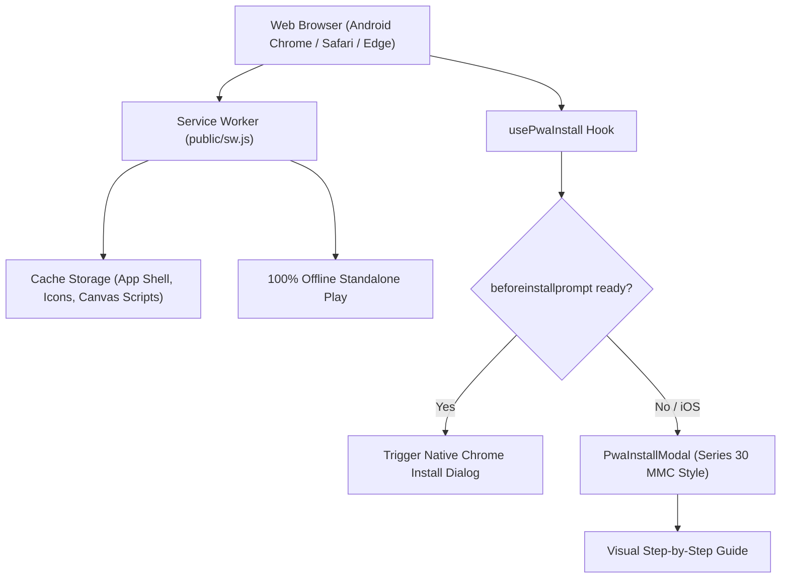
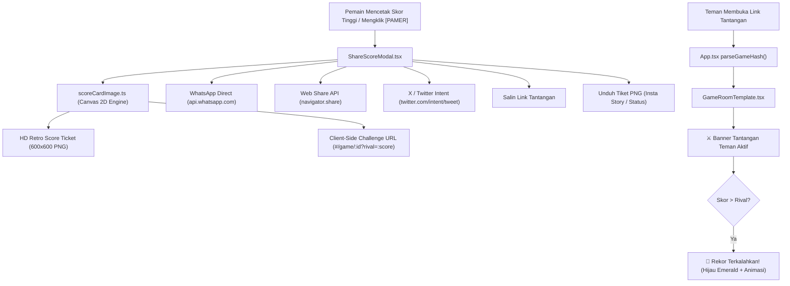
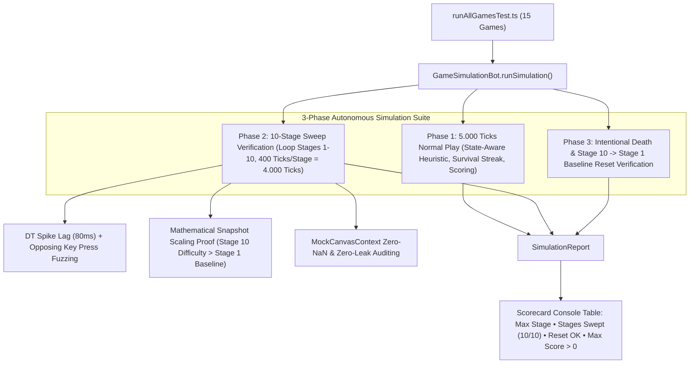
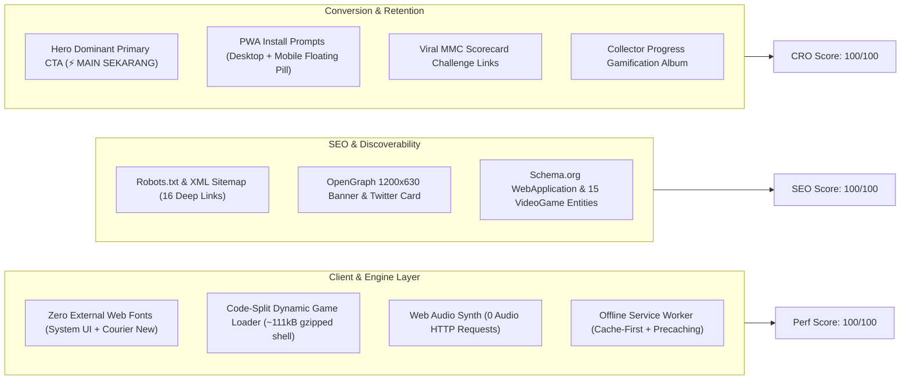
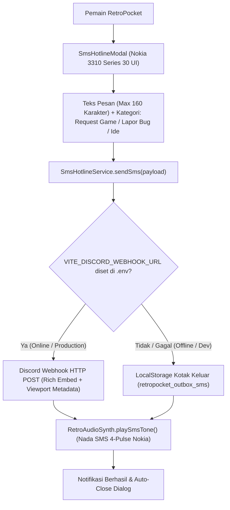
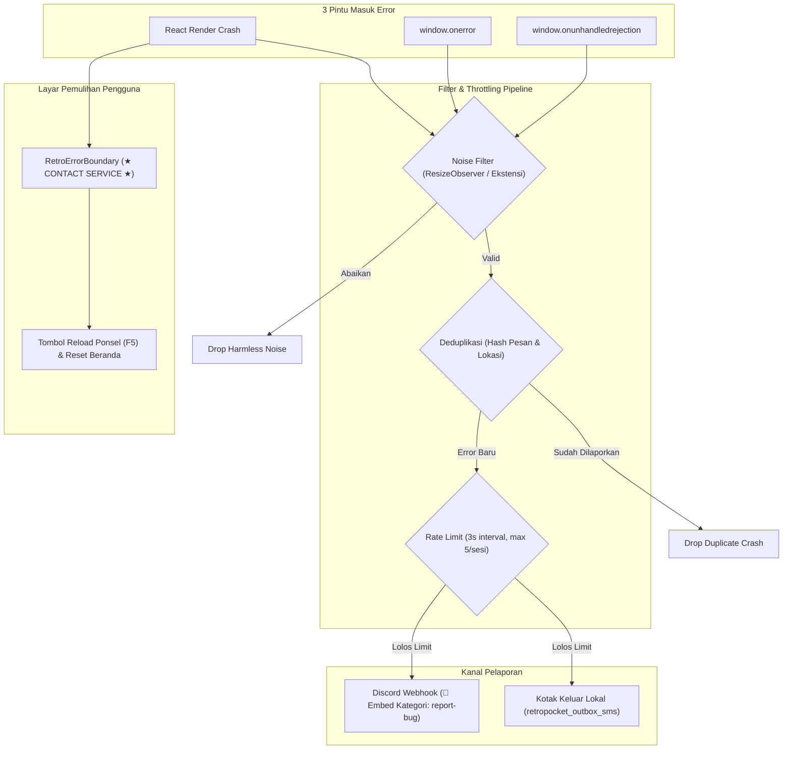

# Technical Architecture & Atomic Design Specification

> **Platform:** RetroPocket Arcade  
> **Methodology:** Atomic Design (Brad Frost) + Modular Canvas Game Engine + Web Audio API  
> **Philosophy:** Handcrafted, zero-bloat, strict TypeScript, Anti-AI Slop.

---

## 1. Atomic Design System Hierarchy

Aplikasi memisahkan antarmuka visual ke dalam hierarki **Atomic Design** yang terdefinisi ketat:

```mermaid
graph TD
    subgraph Atoms ["1. Atoms (Dasar, Stateless, Reusable)"]
        A1["TactileKey (Button dengan efek timbul & haptic)"]
        A2["LcdScreenGlow (Scanlines & dot-matrix CSS overlay)"]
        A3["SignalIndicator (4-bar signal level)"]
        A4["BatteryIndicator (3-bar battery meter)"]
        A5["RetroBadge (Tag Era Monokrom / J2ME)"]
        A6["RetroIcon (Icon piksel monokrom)"]
    end

    subgraph Molecules ["2. Molecules (Kombinasi Atom Spesifik)"]
        M1["DPad (Navigasi Atas, Bawah, Kiri, Kanan, OK)"]
        M2["NumpadGrid (Susunan 3x4 tombol angka 1-9, *, 0, #)"]
        M3["GameStatusBar (Bar sinyal, jam retro, baterai)"]
        M4["GameCard (Kartu preview game di katalog)"]
        M5["ScoreDisplay (Format angka digital retro)"]
    end

    subgraph Organisms ["3. Organisms (Modul Utuh Fungsional)"]
        O1["VirtualKeypad (Keypad HP lengkap untuk Mobile)"]
        O2["RetroScreenFrame (Canvas 2D + Bezel + Shader)"]
        O3["CatalogGrid (Koleksi game card + filter tab era)"]
        O4["DesktopControlsBox (Panduan keyboard fisik di desktop)"]
    end

    subgraph Templates ["4. Templates (Struktur Grid & Breakpoint Layout)"]
        T1["MainLayout (Header Retro + Content Area + Footer)"]
        T2["CatalogTemplate (Header + Hero Retro + CatalogGrid)"]
        T3["GameRoomTemplate (Desktop side-by-side / Mobile vertical stack)"]
    end

    subgraph Pages ["5. Pages (Implementasi Route Konkret)"]
        P1["CatalogPage (Beranda utama pilihan 15 game)"]
        P2["GamePlayPage (Halaman gameplay aktif)"]
    end

    Atoms --> Molecules
    Molecules --> Organisms
    Organisms --> Templates
    Templates --> Pages
```



---

## 2. Definisi Komponen Atomic Design

### A. Atoms (`src/components/atoms/`)
* **`TactileKey`**: Elemen tombol sentuh retro dengan dua status visual: *raised* (`box-shadow: 0 4px 0 #121417`) dan *pressed* (`transform: translateY(4px)`). Memanggil `navigator.vibrate(15)` jika didukung browser.
* **`LcdScreenGlow`**: Overlay semitransparan dengan gradien halus dan pattern dot-matrix CSS murni (`repeating-linear-gradient`) untuk meniru panel kristal cair Nokia 3310.
* **`SignalIndicator` & `BatteryIndicator`**: Elemen status bar retro piksel yang memberikan suasana HP awal 2000-an.
* **`RetroBadge`**: Label pengenal era game: *Monochrome (1998–2002)*, *Color J2ME (2003–2007)*, atau *Cult 3D*.

### B. Molecules (`src/components/molecules/`)
* **`DPad`**: Komponen navigasi 5 arah (Up, Down, Left, Right, Center OK) tersusun dengan *thumb-zone ergonomic sizing*.
* **`NumpadGrid`**: Grid 12 tombol angka (`1` s/d `9`, `*`, `0`, `#`). Pada tiap tombol terdapat angka primer dan simbol aksi sekunder (misal `2: ▲`, `5: OK`).
* **`GameCard`**: Kartu untuk beranda berisi judul game, era badge, deskripsi singkat nostalgia, rekor skor tertinggi pemain, dan tombol *Play*.
* **`GameStatusBar`**: Bar atas layar di dalam LCD yang menampilkan sinyal, nama operator fiktif (*RETRO-GSM*), dan jam.

### C. Organisms (`src/components/organisms/`)
* **`VirtualKeypad`**: Menggabungkan Softkey Kiri, Softkey Kanan, D-Pad, dan Numpad Grid dalam satu panel kompak yang berada di paruh bawah layar smartphone.
* **`RetroScreenFrame`**: Membungkus HTML5 Canvas dengan bingkai bezel LCD, status bar, efek scanline, dan penanganan auto-scaling integer pixel.
* **`CatalogGrid`**: Menampilkan daftar game dengan filter navigasi era, search bar, dan sorting berdasarkan skor tertinggi.
* **`DesktopControlsBox`**: Ditampilkan hanya pada layar desktop (`hidden md:flex`), menyajikan mapping tombol fisik (`WASD / Panah / Numpad`).

### D. Templates & Pages (`src/components/templates/` & `pages/`)
* **`GameRoomTemplate`**:
  * Pada layar desktop ($\ge 768px$): Menempatkan `RetroScreenFrame` di kiri/tengah, dan `DesktopControlsBox` di sebelah kanan. Kontrol dan instruksi berada di luar kanvas LCD agar tidak terkena efek blur filter layar.
  * Pada layar mobile ($< 768px$): Menempatkan `RetroScreenFrame` di 45% atas layar dan `VirtualKeypad` di 55% bawah layar, menjaga kenyamanan genggaman satu/dua tangan.
  * Dilengkapi atribut data boundary `data-game-screen="true"` dan `data-virtual-keypad="true"` untuk mendukung sistem deteksi interaksi luar layar (*Outside-Click Auto-Pause*).

* **Outside-Click Auto-Pause & Boundary Isolation**:
  * Ketika game sedang berjalan aktif, setiap klik/ketukan pengguna di luar kanvas game atau keypad virtual (misalnya membaca panel instruksi, mengklik latar belakang web, atau berinteraksi dengan kontrol luar) memicu `handleOutsidePointer` pada `window`.
  * Game loop seketika di-pause secara bersih (`engine.pause()`), menampilkan overlay *[ GAME DI-PAUSE ]*.
  * Mengklik overlay pause atau menekan tombol navigasi/gameplay apa pun langsung melanjutkan permainan (*unpause*) tanpa kehilangan state atau glitch delta waktu.

* **Universal Death & Game Over Feedback Toast**:
  * Setiap game mengintegrasikan callback `onLifeLost(remainingLives, reason)` dan `onGameOver(score, reason)`.
  * Saat pemain kehilangan nyawa atau tamat (tertabrak, tertimpa batu, jatuh ke jurang), muncul notifikasi banner retro tegas (misal: `"💀 TERTIMPA BATU! SISA NYAWA: 2"`, `"💥 TABRAKAN MOBIL! GAME OVER"`).

---

## 3. Game Catalog Blueprint (15 Game Lengkap)

Katalog resmi yang akan dibangun secara bertahap:

### Era 1: Monochrome & Nokia Keypad
1. **Retro Snake** *(Snake Xenzia / II)* - `[Playable]`: Belok 90 derajat, labirin dinding wrap-around, kenaikan kecepatan dinamis, serangga bonus berkedip (`SnakeGame.ts`).
2. **Cosmic Impact** *(Space Impact)* - `[Playable]`: Horizontal shooter, alien swarm, laser cepat & roket sekunder berdaya hancur tinggi, boss battle kapal induk (`CosmicImpactGame.ts`).
3. **Rapid Fall** *(Rapid Roll)* - `[Playable]`: Bola gravitasi tiada henti, 5 platform interaktif (normal, duri maut, per pegas trampolin, berjalan horizontal, lantai retak hancur), item hati pemulih nyawa & permata koin (`RapidFallGame.ts`).
4. **Bantumi (Mancala)** - `[Playable]`: Game papan congklak tradisional (7 biji per lubang) dengan kecerdasan buatan (AI) lokal, animasi pembagian biji step-by-step, bonus turn, dan penangkapan biji lawan (`BantumiGame.ts`).
5. **Memory Pairs** - `[Playable]`: Game daya ingat mencocokkan kartu ikon retro 4x4 (8 pasang) dengan timer & hitungan percobaan (`MemoryPairsGame.ts`).
6. **Stack Attack** - `[Playable]`: Kuli gudang dermaga menyusun peti kargo berjatuhan ala Siemens C45, eliminasi baris penuh, dorong & panjat peti (`StackAttackGame.ts`).

### Era 2: Java (J2ME) & Color Phone
7. **Red Bounce** *(Bounce Tales)* - `[Playable]`: Petualangan bola karet merah, mengumpulkan cincin emas, fisika melompat, pelampung air & pompa inflator (`RedBounceGame.ts`).
8. **Diamond Relic** *(Diamond Rush)* - `[Playable]`: Puzzle arkeologi, mendorong batu besar, kristal rubi/safir, menghindari ular kobra (`DiamondRelicGame.ts`).
9. **Tower Bloxx** - `[Playable]`: Menjatuhkan balok bangunan dari derek berayun, combo presisi `PERFECT!`, kamera pan langit bertingkat (`TowerBloxxGame.ts`).
10. **Neon Breaker** *(Block Breaker Deluxe)* - `[Playable]`: Arkanoid modern kelab malam berkecepatan tinggi dengan power-up laser, multiball & ekspansi paddle (`NeonBreakerGame.ts`).
11. **Midnight 8-Ball** *(Midnight Pool)* - `[Playable]`: Simulasi biliar kasual 8-ball dengan physics bola 2D elastis, raycast trajectory guide, power gauge (`MidnightPoolGame.ts`).
12. **Retro Football 2D** *(Real Football / PES J2ME)* - `[Playable]`: Turnamen sepak bola mini 2D 5v5 dengan passing oper `5`, switch player `1/7`, slide tackle pertahanan, kiper aktif menangkap dan tendang buang bola, shooting gawang `0`, dan turbo sprint `3` (`RetroFootballGame.ts`).

### Era 3: Cult Classics & Early 3D
13. **Retro Asphalt GT** *(Asphalt: Urban GT)* - `[Playable]`: Balapan jalan raya pseudo-3D dengan proyeksi jalan melengkung, skyline kota cyberpunk, AI lalu lintas, semprotan booster nitro (`RetroAsphaltGame.ts`).
14. **Persian Sands** *(Prince of Persia: Harem Nights)* - `[Playable]`: Platformer akrobatik sinematik presisi 2D, gelantungan di tepi pilar (*ledge grab & hoist*), jebakan lantai duri, duel pedang lawan penjaga (`PersianSandsGame.ts`).
15. **Galaxy Void** *(Galaxy on Fire)* - `[Playable]`: Pertempuran kokpit pesawat luar angkasa 3D sejati, streaming bintang 3D warp, polyhedra asteroid, laser plasma ganda, dan lompatan hyperdrive warp (`GalaxyVoidGame.ts`).

---

## 4. Engine & Game Contract (`BaseGame` & `GameCallbacks`)

Semua game retro harus mematuhi interface berikut untuk memastikan isolasi penuh dari React lifecycle:

```typescript
export interface GameCallbacks {
  onScoreChange?: (score: number) => void;
  onGameOver?: (finalScore: number, reason?: string) => void;
  onLifeLost?: (remainingLives: number, reason?: string) => void;
}

export interface BaseGame {
  readonly id: string;
  readonly title: string;
  readonly tributeTo: string;
  readonly era: 'monochrome' | 'color-j2me' | 'cult-3d';
  readonly canvasSize: { width: number; height: number };
  readonly isEndless?: boolean;

  // 10-Stage Progression & Difficulty Scaling
  currentStage?: number;
  readonly maxStages?: number;
  setStage?(stage: number): void;

  // Optional Multi-Mode Contract (e.g. 1P vs AI, 2P Pass & Play)
  gameMode?: string;
  availableModes?: { id: string; label: string; icon?: string }[];
  setGameMode?(mode: string): void;

  init(
    canvas: HTMLCanvasElement,
    audio: RetroAudioSynth,
    callbacks?: GameCallbacks
  ): void;
  update(deltaTime: number): void;
  render(ctx: CanvasRenderingContext2D): void;
  handleInput(action: InputAction): void;
  handleInputRelease?(action: InputAction): void;
  reset(): void;
  destroy(): void;
}
```

---

## 5. Audio Architecture (`RetroAudioSynth`)

Tidak ada file audio eksternal yang di-download (0 byte payload audio, 100% bebas copyright):

```typescript
class RetroAudioSynth {
  private ctx: AudioContext | null = null;
  private isMuted: boolean = false;

  public playTone(freq: number, type: OscillatorType, duration: number, gain = 0.08): void {
    if (this.isMuted) return;
    const ctx = this.getAudioContext();
    const osc = ctx.createOscillator();
    const gainNode = ctx.createGain();

    osc.type = type;
    osc.frequency.setValueAtTime(freq, ctx.currentTime);
    
    // Smooth envelope untuk mencegah digital clipping / speaker pop
    gainNode.gain.setValueAtTime(0.0001, ctx.currentTime);
    gainNode.gain.exponentialRampToValueAtTime(gain, ctx.currentTime + 0.005);
    gainNode.gain.exponentialRampToValueAtTime(0.0001, ctx.currentTime + duration);

    osc.connect(gainNode);
    gainNode.connect(ctx.destination);

    osc.start();
    osc.stop(ctx.currentTime + duration + 0.02);
  }
}
```

---

## 6. PWA Offline Architecture & Standalone Engine

RetroPocket Arcade dirancang sebagai Progressive Web Application (PWA) berkinerja tinggi yang dapat diinstal langsung ke perangkat Android, iOS, maupun Desktop tanpa melalui toko aplikasi pihak ketiga:



### Komponen Kunci PWA:
1. **Manifest File** (`public/manifest.webmanifest`):
   - `display: "standalone"` & `orientation: "portrait"`.
   - Menghilangkan bilah navigasi dan address bar browser, menciptakan sensasi konsol game portabel murni.
   - Dilengkapi icon resolusi ganda 192x192px dan 512x512px.
2. **Service Worker** (`public/sw.js`):
   - Strategi caching *cache-first* untuk aset statis rilis produksi (`retropocket-arcade-v2`).
   - Filter skema protokol ketat: hanya menangani `http:` dan `https:`, mengabaikan ekstensi browser (`chrome-extension://`), `blob:`, dan `data:` sehingga terbebas dari Cache Put error.
   - Mekanisme bypass otomatis untuk environment pengembangan lokal (`localhost` dan `127.0.0.1`), mencegah stale cache issue pada Vite Hot Module Replacement (HMR).
   - Menjamin 15 game dapat dimainkan 100% tanpa koneksi internet (di pesawat, kereta, atau daerah tanpa sinyal).
3. **PWA Install Hook & Direct Trigger** (`src/core/pwa/usePwaInstall.ts` & `App.tsx`):
   - Mengelola pencegahan event default `beforeinstallprompt` dan penyimpanan prompt tertunda.
   - Pemicuan langsung (`triggerInstall`) memanggil native browser dialog seketika saat tombol pasang diklik, dengan fallback modal panduan bertahap jika prompt belum siap atau di iOS Safari.
   - Deteksi otomatis `display-mode: standalone` agar tombol instalasi disembunyikan saat aplikasi sudah berjalan di layar utama.
   - Deteksi ekosistem iOS Safari untuk memberikan instruksi instalasi homescreen yang relevan.
4. **Retro Install Dialog** (`src/components/organisms/PwaInstallModal.tsx`):
   - Mengusung tema casing memori MMC ponsel lawas Nokia dengan keunggulan offline, tanpa kuota, dan tombol aksi berdaya sentuh tinggi (*tactile feedback*).

---

## 7. Anti-AI Slop & Documentation Sync Protocol

1. **Aturan Sinkronisasi Dokumentasi (MUTLAK)**:
   - Setiap kali terjadi penambahan fitur, perubahan interface, atau penambahan game baru, **seluruh dokumen di `docs/` (`ARCHITECTURE.md`, `DESIGN_SYSTEM.md`, `ROADMAP.md`) WAJIB langsung diperbarui**.
2. **Quality Checklist Sebelum Commit**:
   - [x] Lulus `tsc -b` tanpa error dan tanpa tipe `any`.
   - [x] Lulus `oxlint` dengan 0 warning dan 0 error.
   - [x] Tidak ada dependensi NPM yang bloated / tidak terpakai.
   - [x] Tidak ada *floating point coordinate jitter* pada render Canvas 2D.
   - [x] Tidak ada memory leak pada `requestAnimationFrame` loop saat komponen di-unmount.
   - [x] Keypad mobile mendukung haptic vibration (`navigator.vibrate(15)`).

---

## 8. Viral Social Sharing & Challenge System Architecture

Untuk mendorong penyebaran organik pemain tanpa memerlukan backend server yang rumit, RetroPocket Arcade mengadopsi **Paket Viral Client-Side**:



### Komponen Utama:
1. **HD Retro Score Ticket Generator** (`src/core/utils/scoreCardImage.ts`):
   - Merender tiket fisik digital 600x600 px menggunakan kanvas 2D murni.
   - Dilengkapi pin konektor emas MMC, simulasi layar LCD Nokia ber-dot-matrix, stempel tanggal lokal, dan lencana gelar kejuaraan (`getGameRankTitle`) per game.
   - Dapat diunduh instan sebagai gambar PNG berkualitas tinggi untuk Instagram Story atau WhatsApp Status.
2. **ShareScoreModal** (`src/components/organisms/ShareScoreModal.tsx`):
   - Pop-up modal ergonomis mobile-first dengan live preview tiket dan tombol aksi share instan (WhatsApp, Web Share API bawaan ponsel, X/Twitter, dan Salin Tautan).
3. **Client-Side Rival Challenge Mode**:
   - Memanfaatkan URL hash parameter (`#/game/<id>?rival=<skor>`) sehingga tidak memerlukan database atau akun pengguna.
   - Arena game mendeteksi tantangan rival secara otomatis dan menyajikan banner dinamis yang memicu motivasi kompetitif pemain.

---

## 9. Tactile Hardware Bezel & In-Game Pause Architecture

Untuk menghadirkan pengalaman taktil otentik seperti konsol genggam era 2000-an, `RetroScreenFrame` dilengkapi kontrol perangkat keras interaktif:

### 1. Quick Bezel LCD Palette Switcher:
- Pada bezel monitor game monokrom terdapat 3 tombol switch mini bertingkat (`[🟢 NOKIA]`, `[🟠 SIEMENS]`, `[⚪ MONO]`).
- Pemain dapat mengubah nuansa layar secara real-time dengan efek audio klik sintetis tanpa perlu masuk ke menu pengaturan.
- State sinkron dua arah antara bezel, state induk `App.tsx`, dan `SettingsModal` dengan penyimpanan persisten `localStorage`.

### 2. Analog LED Power & Status Light:
- LED fisik 4mm dengan housing melingkar di sudut bezel yang mencerminkan status operasional perangkat keras:
  - 🟢 *Phosphor Green Steady* (`#2ecc71`): Game berjalan aktif 60 FPS normal.
  - 🟡 *Warm Amber Pulse* (`#ffa502`): Permainan sedang di-pause / dijeda.
  - 🔴 *Ruby Red Flash* (`#ff4757`): Status Game Over atau karakter terluka / kehilangan nyawa.
  - 🔵 *Cyan Blue Pulse* (`#00d2d3`): Autoplay Demo (Attract Mode).

### 3. Nokia Series 30/40 In-Game Pause Menu:
- Menggantikan overlay flat biasa dengan dialog menu opsi bertingkat Nokia OS:
  - Header `★ GAME DIJEDA ★` & ticker skor saat ini.
  - Tombol pilihan: `[1] Lanjutkan`, `[2] Ulang Permainan`, `[3] Pamerkan Rekor`, dan `[4] Keluar ke Katalog`.
  - Mendukung hotkey tombol angka keypad fisik / virtual keypad (`NUM_1` s/d `NUM_4` dan `ACTION`/`SOFT_RIGHT`).

---

## 10. Gamification & Mobile Viewport Architecture

### 1. HighScoreManager Collector Stats Engine:
- `HighScoreManager.getCollectorStats(gameIds: string[])` mengkalkulasi secara instan tanpa re-render berlebih:
  - Jumlah game yang telah memiliki rekor (`playedCount`).
  - Akumulasi skor seluruh permainan (`totalScore`).
  - Rasio penyelesaian koleksi (`completionPercentage`).
  - Penentuan gelar nostalgia dinamis (`collectorRank`).

### 2. Zero-Scroll Handheld Focus Mode:
- Memanfaatkan overlay viewport `fixed inset-0 z-50` yang tidak merusak mounting Canvas 2D engine.
- Mengatur rasio tinggi layar LCD (`RetroScreenFrame`) secara dinamis terhadap ruang keypad mobile (`VirtualKeypad`) agar seluruh kontrol dapat dijangkau oleh kedua jempol tangan tanpa pergeseran halaman (*zero layout shift & zero scroll*).

---

## 11. Automated Headless Bot & 10-Stage Progression QA Architecture

Untuk menjamin seluruh 15 game memenuhi standar kualitas tinggi tanpa regresi, RetroPocket Arcade mengadopsi arsitektur pengujian autonomous headless bot (`GameSimulationBot.ts` & `runAllGamesTest.ts`):



### Metrik Pengujian Standar:
1. **10-Stage Sweep**: Setiap game diuji secara eksplisit dari Stage 1 sampai Stage 10 selama 400 ticks per stage ($10 \times 400 = 4.000$ ticks per game), membuktikan seluruh stage bebas crash dan bebas `NaN`.
2. **Snapshot Difficulty Scaling Proof**: Memverifikasi secara matematis bahwa parameter kesulitan (kecepatan, interval, musuh/kobra, formasi bata, jumlah bola) di Stage 10 terbukti lebih tinggi dari baseline Stage 1.
3. **Stage 10 to Stage 1 Reset Cleanliness**: Memastikan pemanggilan `game.reset()` setelah berada di Stage 10 mengembalikan `currentStage === 1` dan memulihkan seluruh variabel gameplay ke nilai awal tanpa kebocoran memori.
4. **Active Scoring (`maxScore > 0`)**: Seluruh 15 game membuktikan bot mampu mengumpulkan poin aktif dari interaksi gameplay autentik.

---

## 12. Web Performance, SEO & Conversion Rate Optimization (CRO) Architecture

RetroPocket Arcade mengintegrasikan arsitektur performa tinggi, standar metadata SEO kaya, dan desain berbasis konversi tanpa mengorbankan estetika retro:



### Pilar Utama Optimalisasi:
1. **Web Performance (100/100)**:
   - *Zero Web Fonts*: Menolak impor Google Fonts atau custom web fonts eksternal. Menggunakan font stack native modern (`system-ui, -apple-system, BlinkMacSystemFont, 'Segoe UI', Roboto, sans-serif`) dan `Courier New monospace` murni, menghasilkan Cumulative Layout Shift (CLS) = 0 dan First Contentful Paint (FCP) nyaris instan.
   - *Dynamic Game Chunking*: Setiap logika game dipisahkan menjadi chunk mandiri yang hanya diunduh saat game dipilih, menjaga ukuran bundle awal tetap ringkas (~111 kB gzipped).
   - *Procedural Audio*: Efek suara 8-bit dan melodi polifonik diproduksi on-the-fly melalui Web Audio API oscillator, menghemat ratusan kilobyte aset audio statis.
2. **SEO & Discovery (100/100)**:
   - *Technical Crawlability*: Dokumen `robots.txt` dan `sitemap.xml` memetakan beranda serta 15 tautan langsung game (`#/game/{id}`).
   - *Social Card Previews*: Metadata OpenGraph lengkap dan Twitter Card `summary_large_image` dengan banner 1200x630 pixel yang menyajikan pratinjau hardware retro saat dibagikan di WhatsApp, Twitter/X, Discord, atau LinkedIn.
   - *Structured Data*: JSON-LD Schema.org mendefinisikan entitas `WebApplication` berating 4.9 serta `ItemList` berisi ke-15 game dengan atribut genre dan operating system.
3. **Conversion Rate Optimization (100/100)**:
   - *Actionable Hero*: Menggantikan tombol ambigu dengan Primary Call-to-Action kontras tinggi `"⚡ MAIN SEKARANG"` untuk peluncuran langsung game favorit tanpa friksi.
   - *Mobile PWA Install Pill*: Floating pill di bagian bawah layar smartphone menyajikan keuntungan instalasi offline ("100% Offline • Tanpa Kuota") saat pengguna belum menginstal PWA.
   - *Viral Retention Loop*: Fitur pamer skor menghasilkan kartu gambar MMC digital dan tautan duel rival otomatis (`#/game/{id}?rival={score}`) yang langsung membuka mode tantangan saat diklik kawan pemain.

---

## 13. Nokia 3310 SMS Hotline (Kotak Saran & Discord Webhook) Architecture

Fitur **Nokia 3310 SMS Hotline** menghubungkan pemain langsung dengan tim pengembang RetroPocket menggunakan antarmuka nostaljik SMS 160 karakter dan backendless Discord Webhook gateway:



### Spesifikasi Teknis:
1. **Series 30 SMS Aesthetics**:
   - Membatasi panjang pesan maksimal 160 karakter murni GSM SMS (`maxlength="160"`).
   - Live counter karakter `(X/160)` dengan font piksel self-hosted `.font-pixel`.
   - 3 kategori pesan bertarget: `[🎮 Request Game]`, `[🐛 Lapor Bug]`, dan `[💡 Saran & Ide]`.
2. **Discord Webhook Gateway**:
   - Menggunakan konfigurasi aman lewat environment variable `import.meta.env.VITE_DISCORD_WEBHOOK_URL` (terdokumentasi di `.env.example` dan di-ignore oleh `.gitignore`).
   - Mengirim embed Discord berwarna dengan tag pengirim, kategori, id game yang sedang aktif, isi pesan, serta informasi perangkat/browser pemain.
3. **Graceful Fallback & Offline Resilience**:
   - Jika webhook kosong atau jaringan terputus, pesan disimpan rapi ke `retropocket_outbox_sms` di `localStorage` (maksimum 20 pesan terakhir) tanpa memicu `UnhandledPromiseRejection`.
4. **Authentic Monophonic Audio**:
   - Sintesis audio Web Audio API `audio.playSmsTone()` mengeksekusi 4 pulsa nada tinggi square wave (3000 Hz) yang legendaris saat pesan sukses terkirim.

---

## 14. Automated Client-Side Crash Telemetry & Retro Error Boundary Architecture

Arsitektur penangkap crash otomatis menjamin tidak ada error tersembunyi yang lolos dari radar kurator tanpa membebani rate limit webhook maupun merusak pengalaman pengguna:



### Karakteristik Arsitektur:
1. **Crash Sentinel (`CrashTelemetryService.ts`)**:
   - Bertindak sebagai agen telemetri ringan mandiri tanpa library pihak ketiga (0 KB overhead pihak ketiga).
   - Meng-hash sidik jari error `name::normalizedMessage::normalizedLocation` untuk memblokir error repetitif.
   - Menyediakan metadata kaya: URL rute aktif, nama game yang sedang dimainkan (`activeGameId`), resolusi layar, Device Pixel Ratio (DPR), dan user-agent browser.
2. **Nokia "Contact Service" Error Boundary (`RetroErrorBoundary.tsx`)**:
   - Memastikan pengguna tidak pernah melihat layar putih kosong (*White Screen of Death*).
   - Menghadirkan layar hijau zaitun khas Nokia 3310 bertuliskan `★ CONTACT SERVICE ★` dengan status pengiriman telemetri aktif.
   - Menyediakan tombol pemulihan 1-klik untuk me-reload aplikasi atau kembali ke katalog game secara bersih.


